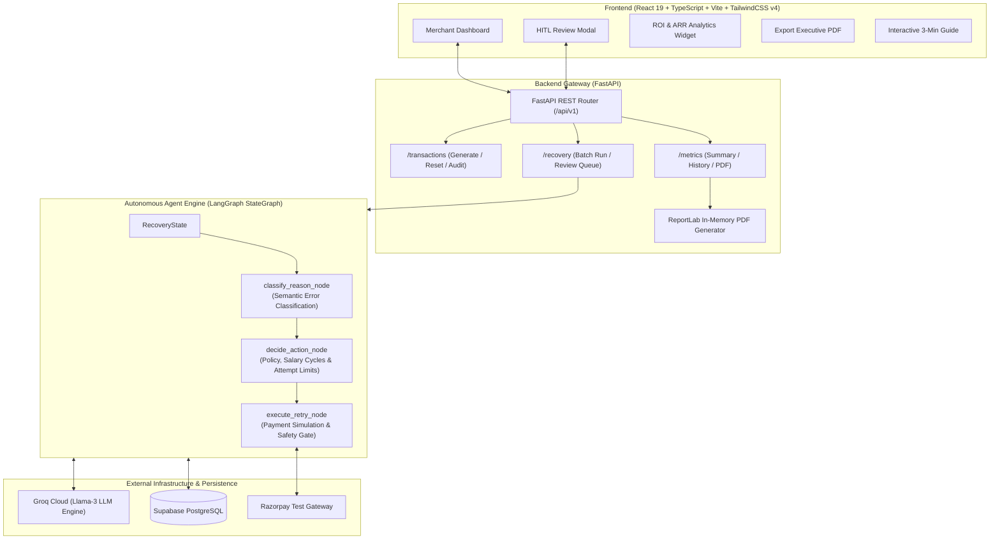

# 🛡️ RecoupAI — Autonomous AI Revenue Recovery Engine

> **Intelligent, Agentic Payment Failure Recovery with Temporal Retries & Human-in-the-Loop Safeguards for Modern Fintech & Subscription Businesses.**

[](https://fastapi.tiangolo.com)
[](https://langchain-ai.github.io/langgraph/)
[](https://groq.com)
[](https://supabase.com)
[](https://react.dev)
[](https://tailwindcss.com)
[](https://www.docker.com)
[](https://www.reportlab.com)

---

## 📌 Executive Summary & The Problem

In digital subscriptions and recurring commerce, **15%–40% of all customer churn is involuntary**—customers never intended to cancel; their payment simply failed due to temporary network glitches, expired credentials, or transient liquidity shortages.

Today, businesses handle payment failures in two broken ways:
1. **Passive Acceptance:** Abandoning failed transactions, losing tens of thousands in recurring Annual Recurring Revenue (ARR).
2. **Dumb / Blind Retries:** Hammering card networks with brute-force automated scripts. This triggers **₹15–₹25 penalty fees per bounce**, irritates customers, damages merchant risk scores, and yields a meager **~22% industry benchmark recovery rate**.

### 💡 The Solution: RecoupAI
**RecoupAI** replaces dumb retry scripts with an **autonomous LangGraph state machine**. It classifies raw gateway failure telemetry, applies smart temporal retry policies based on transaction physics and salary cycles, executes human-in-the-loop approvals for high-risk payments, and delivers an industry-leading **~75% recovery rate (a 3.2x uplift)** while eliminating unnecessary bounce fees.

---

## 🏛️ System Architecture

RecoupAI coordinates an agentic state machine, event telemetry, database persistence, and an interactive merchant dashboard.



---

## 🔄 Multi-Run Resolution & Human-in-the-Loop Lifecycle

RecoupAI uses a deterministic multi-attempt resolution lifecycle aligned with actual consumer financial rhythms:

| Attempt Phase | Trigger & Failure Archetype | Agent Action & Behavior | Recovery Impact |
| :--- | :--- | :--- | :--- |
| **Run 1: Instant Fixes** | **Bank Timeouts** (`bank_timeout`, `gateway_error`) | Transient network error. Retried immediately without delay. | **~35% Initial Recovery** (~85% timeout resolution) |
| **Run 2: Temporal Resolution** | **Insufficient Funds** & **Expired Cards** | Aligns retries to salary deposit cycles (1st/5th of month) and dispatches customer card-update dunning flows. | **~60% Cumulative Recovery** |
| **Run 3: Stopping Rule** | **Unrecoverable Cards** | Hard ceiling after 3 attempts halts retries, marking status `exhausted` to avoid ₹15–₹25 bank penalty fees. | **~75% Final Recovery** |
| **Safety Gate: HITL** | **High-Ticket (≥ ₹10k)** or **Fraud Flags** | Execution paused into `pending_human_review`. Risk Officer reviews AI reasoning to `approve` or `reject`. | **100% Risk Compliance** |

---

## 🎯 3-Minute Interactive Demo Walkthrough

Follow this step-by-step sequence in the Merchant Dashboard (`http://localhost:5173`):

1. **Inject Synthetic Data:** Click **⚡ Inject 10 Payments** in the top navigation bar. This generates 10 realistic payment failures across the 4 archetypes (bank timeout, insufficient funds, expired card, fraud).
2. **Run 1st Recovery Batch (Instant Fixes):** Click **▶ Run Recovery Batch**. The LangGraph agent classifies transactions; bank timeouts resolve immediately, lifting the recovery rate to **~35%**.
3. **Run 2nd Recovery Batch (Temporal Resolution):** Click **▶ Run Recovery Batch** again. Simulated salary dates and customer card updates trigger successful retries, climbing to **~60% cumulative recovery**.
4. **Run 3rd Recovery Batch (Stopping Rule):** Click **▶ Run Recovery Batch** a third time. The agent applies terminal stopping policies to unrecoverable accounts, avoiding bounce fees and locking final recovery at **~75%**.
5. **Human-in-the-Loop Risk Review:** When the amber alert banner appears (**⚠️ Payments Awaiting Risk Sign-Off**), click **Review Next**. Inspect the LLM's explanation and click **[Approve Retry]** or **[Confirm Fraud Block]**.
6. **Export Audit Report:** Click **📥 Export Report** to download an executive, in-memory generated PDF summary.
7. **Reset State:** Click **📖 Guide** → *Resetting the System* or hit `/reset` to wipe test data and rerun.

---

## 📂 Repository Structure

```
.
├── backend/                             # FastAPI + LangGraph + Supabase backend
│   ├── app/
│   │   ├── agents/                      # LangGraph StateGraph & decision logic
│   │   │   ├── nodes/                   # classify_reason, decide_action, execute_retry
│   │   │   ├── prompts/                 # System prompts for categorization & policy
│   │   │   ├── graph.py                 # StateGraph compilation & edge definitions
│   │   │   └── state.py                 # RecoveryState TypedDict definition
│   │   ├── api/                         # API routers and dependency injection
│   │   │   ├── v1/                      # Versioned endpoints (transactions, recovery, metrics)
│   │   │   └── deps.py                  # Shared FastAPI dependencies
│   │   ├── db/                          # Database connections & repositories
│   │   │   ├── repositories/            # Recovery attempt repository layer
│   │   │   ├── client.py                # Supabase client singleton
│   │   │   └── schema.sql               # PostgreSQL tables (transactions, recovery_attempts, batch_summaries)
│   │   ├── services/                    # Business services
│   │   │   ├── recovery_service.py      # Batch orchestration & HITL resolver
│   │   │   ├── pdf_service.py           # ReportLab dynamic PDF generator
│   │   │   ├── summary_service.py       # Metrics aggregation & ARR calculations
│   │   │   ├── llm_service.py           # Groq Llama-3 client
│   │   │   └── razorpay_service.py      # Razorpay payment retry stub
│   │   ├── config.py                    # Pydantic BaseSettings (.env loading)
│   │   └── main.py                      # FastAPI application entry & CORS
│   ├── scripts/                         # CLI utilities & diagnostic tools
│   │   ├── seed_db.py                   # Seed Supabase with realistic failure distributions
│   │   ├── simulate_time_passing.py     # Time-travel schedule simulator (hours offset)
│   │   ├── test_agent_node.py           # CLI diagnostic harness for individual agent nodes
│   │   └── generate_synthetic_data.py   # Synthetic failed payment payload generator
│   ├── tests/                           # Pytest automated test suite
│   │   ├── integration/                 # End-to-end API & pipeline integration tests
│   │   └── unit/                        # Unit tests for classification & stopping rules
│   ├── requirements.txt                 # Backend Python dependencies
│   └── README.md                        # Backend documentation
│
├── frontend/                            # React 19 + TypeScript + Vite + TailwindCSS v4 frontend
│   ├── src/
│   │   ├── api/                         # Axios client and typed endpoint methods
│   │   ├── components/
│   │   │   ├── dashboard/               # Headline metrics, HITL modal, ROI cards, guide
│   │   │   ├── transactions/            # Transaction details modal
│   │   │   └── ui/                      # Buttons, badges, and shared UI primitives
│   │   ├── pages/                       # Dashboard page view
│   │   ├── types/                       # TypeScript models (Transaction, RecoveryAttempt, BatchSummary)
│   │   ├── App.tsx                      # Root component
│   │   └── main.jsx                     # Application mount point
│   ├── Dockerfile                       # Multi-stage production build (Node 20 + Nginx)
│   ├── nginx.conf                       # Production Nginx SPA routing & asset caching
│   ├── package.json                     # Dependencies (React 19, Tailwind v4, Recharts)
│   └── README.md                        # Frontend documentation
│
├── graphify-out/                        # Graph analysis, god-node mappings & architecture insights
└── README.md                            # Main project documentation (this file)
```

---

## ⚡ Quick Start & Local Setup

### 1. Clone the Repository
```bash
git clone https://github.com/abhaysingh-22/Razorpay.git
cd Razorpay
```

### 2. Configure Database (Supabase)
1. Create a free project at [supabase.com](https://supabase.com).
2. Open the **SQL Editor** in your Supabase dashboard.
3. Copy and run the schema definitions from [backend/app/db/schema.sql](file:///Users/abhaysingh22_/Developer/Razorpay/backend/app/db/schema.sql):
   - `transactions`
   - `recovery_attempts`
   - `batch_summaries`

### 3. Configure & Launch Backend
```bash
cd backend

# Create and activate virtual environment
python3 -m venv .venv
source .venv/bin/activate

# Install dependencies
pip install -r requirements.txt

# Create .env from template
cp .env.example .env
```

Populate `backend/.env` with your API credentials:
```ini
# Supabase
SUPABASE_URL=https://your-project.supabase.co
SUPABASE_KEY=your-supabase-service-role-key

# Groq LLM
GROQ_API_KEY=gsk_your_groq_api_key

# Razorpay (Test Mode)
RAZORPAY_KEY_ID=rzp_test_xxxx
RAZORPAY_KEY_SECRET=your_test_secret

# Application
ENV=development
```

Start the FastAPI development server:
```bash
uvicorn app.main:app --host 0.0.0.0 --port 8000 --reload
```
Interactive API documentation will be available at:
- Swagger UI: `http://localhost:8000/docs`
- Redoc: `http://localhost:8000/redoc`

### 4. Configure & Launch Frontend
In a new terminal:
```bash
cd frontend

# Install Node dependencies
npm install

# Set API URL
echo "VITE_API_URL=http://localhost:8000/api/v1" > .env

# Start Vite dev server
npm run dev
```
Open your browser at **`http://localhost:5173`**.

---

## 🛠️ CLI Utilities & Diagnostic Scripts

The `backend/scripts/` folder provides tools for seeding data, evaluating agent nodes, and simulating temporal progression:

```bash
cd backend
source .venv/bin/activate

# 1. Seed database with synthetic failed transactions
python -m scripts.seed_db --count 30 --wipe

# 2. Time-Travel Clock Simulation (shifts next_retry_at backwards to trigger queues)
python -m scripts.simulate_time_passing --hours 24

# 3. Test agent nodes, compiled StateGraph, and batch execution in CLI
python -m scripts.test_agent_node --all

# 4. Generate synthetic transaction JSON payload or insert directly
python -m scripts.generate_synthetic_data --count 20 --insert
```

---

## 📡 REST API Reference

| Method | Endpoint | Description |
| :--- | :--- | :--- |
| **System** | | |
| `GET` | `/health` | Basic server health check (`{"status": "ok"}`) |
| `GET` | `/` | Root service info endpoint |
| `POST` / `GET` | `/reset` | Root convenience shortcut to wipe database |
| `GET` | `/export-pdf` | Root shortcut to download latest PDF report |
| **Transactions** | | |
| `POST` | `/api/v1/transactions/generate?count=10` | Injects synthetic failed payment scenarios into Supabase |
| `POST` / `GET` | `/api/v1/transactions/reset` | Resets and wipes test transactions, attempts, and summaries |
| `GET` | `/api/v1/transactions/?status=failed` | Lists transactions filtered by status |
| `GET` | `/api/v1/transactions/{id}` | Fetches transaction detail and complete recovery attempt audit history |
| **Recovery** | | |
| `POST` | `/api/v1/recovery/run` | Triggers agentic batch recovery across due transactions |
| `GET` | `/api/v1/recovery/review-queue` | Returns transactions paused for Human-in-the-Loop review |
| `POST` | `/api/v1/recovery/review-queue/{id}/resolve` | Resolves review with human verdict (`approve` or `reject`) |
| `GET` | `/api/v1/recovery/attempts` | Fetches historical log of agent recovery decisions |
| **Metrics** | | |
| `GET` | `/api/v1/metrics/summary` | Returns headline recovery rate, amount at risk, and ARR ROI metrics |
| `GET` | `/api/v1/metrics/history` | Historical recovery performance across batch runs |
| `GET` | `/api/v1/metrics/export-pdf` | Streams executive audit PDF binary (`application/pdf`) |

---

## 🐳 Docker Deployment

The frontend includes a production-grade multi-stage `Dockerfile` and custom `nginx.conf`:

```bash
# Build frontend Docker image
docker build -t recoupai-frontend ./frontend

# Run container on port 80
docker run -d -p 80:80 --name recoupai-ui recoupai-frontend
```

---

## 🧪 Testing & Verification

Run backend unit and integration test suites:
```bash
cd backend
source .venv/bin/activate

# Run all test suites with verbose output
pytest tests/ -v
```

Tests include:
- `tests/unit/test_classify_reason.py`: Verifies failure reason normalization into 4 core archetypes.
- `tests/unit/test_stopping_rule.py`: Enforces max attempt stopping policies (Attempt 4+ cutoff and fraud escalation).
- `tests/integration/test_recovery_flow.py`: Verifies end-to-end API flows, batch execution, ROI computation, PDF generation, and HITL approvals.

Run frontend linting:
```bash
cd frontend
npm run lint
```

---

## 📄 Subsystem Documentation
- [Backend Documentation](file:///Users/abhaysingh22_/Developer/Razorpay/backend/README.md)
- [Frontend Documentation](file:///Users/abhaysingh22_/Developer/Razorpay/frontend/README.md)
- [Database Schema (SQL)](file:///Users/abhaysingh22_/Developer/Razorpay/backend/app/db/schema.sql)
- [Architecture & Graph Report](file:///Users/abhaysingh22_/Developer/Razorpay/graphify-out/GRAPH_REPORT.md)

